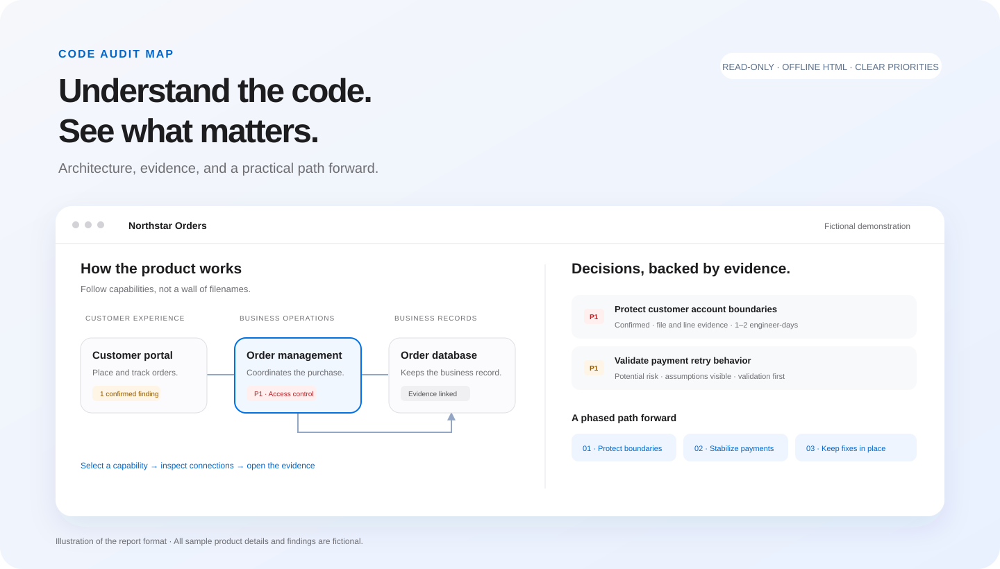
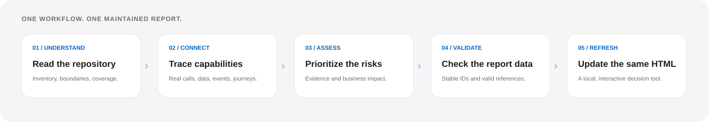

# Code Audit Map

[English](README.md) | **简体中文**


一个可复用的 Codex Skill：把代码仓库转化为非技术用户也能理解的交互式架构地图，以及有证据支撑的代码审查报告。

看清软件的职责、模块之间的关系、值得关注的风险，以及下一步最有价值的改进，同时保留被审查仓库的源代码。



*上图为功能示意。仓库中的演示使用虚构的订单平台，不能作为真实项目的审查结果。*

## 为什么使用它

技术问题清单只有与系统实际运作方式联系起来，才方便做决策。Code Audit Map 将架构、风险和业务影响放进同一份报告，帮助产品负责人、设计师、项目管理者与工程师讨论投入优先级。

Skill 引导 AI Agent 按资深软件工程师的工作方式阅读和评估仓库；Python 渲染器负责校验结构化数据并生成 HTML。渲染器本身不会发现缺陷，也不会自动为代码打分。

## 主要能力

- **按业务能力组织地图。** 用“客户下单”“身份检查”“订单存储”等职责解释系统，而不是堆叠文件名。
- **可点击的模块关系与用户流程。** 查看直接连接，或跟随请求、数据、事件与部署路径。
- **有证据的发现。** 包含 P0–P3 严重程度、确定性、文件与行号、技术及业务影响、改进建议、工作量假设和验证方法。
- **明确表达不确定性。** 区分已确认问题、潜在风险、假设、推断关系及未审查区域。
- **分阶段改进路线。** 按风险、收益和依赖关系安排控制风险、验证、稳定性及局部改进工作。
- **持续更新同一份报告。** 后续审查复用原来的 HTML 和 JSON 路径，保留持续存在问题的编号。
- **Apple 风格的呈现。** 系统字体、充分留白、圆角卡片、半透明导航、克制的蓝色强调，以及打印版详细内容。
- **离线查看。** HTML 内嵌数据、样式、脚本和 SVG 地图，查看时无需联网。

## 工作流程



```text
代码仓库
  → 建立文件清单并理解系统
  → 追踪业务能力、边界与真实流程
  → 审查证据并排列风险优先级
  → 校验 audit-data.json
  → 创建或更新同一个 code-audit.html
```

审查覆盖架构、项目结构、依赖、职责分离、安全、性能、测试、可维护性和部署实践。静态代码结论、实际测量与生产环境验证会分别说明。

## 输出内容

| 文件 | 用途 |
| --- | --- |
| `code-audit.html` | 交互式报告：管理摘要、架构评估、代码地图、代表性流程、优先级问题表、改进路线和审查覆盖情况。 |
| `audit-data.json` | 用于复现和更新 HTML 的结构化数据。 |

每项发现包含严重程度及理由、类别与描述、已确认或潜在风险的标记、文件与行号证据、技术影响、业务影响、改进建议、工作量范围及假设，以及验证标准。

## 安装

需要支持本地 Skill 的 Codex、仓库读取权限，以及 Python 3.9 或更新版本。渲染器仅依赖 Python 标准库。以下克隆命令还需要 Git。

### 个人安装

当前 Codex 官方文档将 `~/.agents/skills` 列为用户级 Skill 路径，详见[官方说明](https://learn.chatgpt.com/docs/build-skills)。

**macOS / Linux**

```bash
mkdir -p ~/.agents/skills
git clone https://github.com/ellenWang918/code-audit-map.git ~/.agents/skills/code-audit-map
```

**Windows PowerShell**

```powershell
$skillParent = Join-Path $env:USERPROFILE '.agents\skills'
New-Item -ItemType Directory -Force -Path $skillParent | Out-Null
git clone https://github.com/ellenWang918/code-audit-map.git (Join-Path $skillParent 'code-audit-map')
```

如果已经在你的 Codex 能识别的其他路径安装过该 Skill，请更新已有副本，避免出现多个同名 Skill。

### 项目内安装

在目标项目根目录运行：

```bash
git clone https://github.com/ellenWang918/code-audit-map.git .agents/skills/code-audit-map
```

Skill 文件夹存放审查指令与渲染器，与项目生成的审查报告分开。Codex 会自动检测 Skill；未出现时可重启 Codex。

## 使用

在 Codex 中打开需要审查的仓库，然后发送：

```text
使用 $code-audit-map 审查整个仓库，不修改源代码。
面向非技术读者解释架构与业务影响，生成交互式 HTML 报告和分阶段改进路线。
```

后续更新时：

```text
使用 $code-audit-map 重新审查这个仓库。
更新原路径下已有的 HTML 和 audit-data 文件，重新核对证据，
并说明相较上次审查的重要变化。
```

可以同时指定固定输出目录、业务背景、审查范围和说明语言。内置报告的界面标签目前使用英文。

## 报告位置与重复运行

未指定目录时，首次审查会在被审查仓库外使用固定目录：

```text
<仓库父目录>/.code-audit-map/<仓库文件夹名称>/
├── audit-data.json
└── code-audit.html
```

已有报告或用户指定的路径优先。后续运行更新相同文件，默认不产生日期版、编号版或重复 HTML。

Agent 重新检查清单、架构、证据、问题、覆盖情况和路线图。持续存在的问题保留编号；只有验证问题已解决后，才从活跃发现中移除。未检查到的区域不能视为已修复。

渲染器会识别同一项目已有的报告，校验成功后以原子替换方式更新 HTML。输入无效或替换失败时保留上一份有效 HTML。其他项目的报告和无关文件默认受到保护。JSON 与 HTML 是两个文件，Agent 必须完成并核对两者后，才能宣布更新完成。

## 体验虚构演示

下载或克隆仓库后，在浏览器中打开 [examples/code-audit.html](examples/code-audit.html)。GitHub 文件页展示的是源码；下载 HTML 后才能操作地图。

在本仓库根目录重新生成演示：

```bash
python scripts/render_audit.py --input examples/audit-data.json --output examples/code-audit.html
```

重复运行同一命令，会更新同一个文件。演示中的产品、证据、问题和工作量均为虚构内容。

仅校验数据：

```bash
python scripts/render_audit.py --input examples/audit-data.json --validate-only
```

真实审查可添加 `--root /path/to/repository`，检查引用文件与行号范围；报告应输出到该目录之外。演示没有对应的真实源码，因此不要为它添加 `--root`。

## 隐私与只读边界

- 工作流要求保留目标仓库的源码、测试、依赖清单、锁文件、配置、Git 状态及已有改动。
- 审查不授权自动修复、安装依赖、数据库迁移、部署或生产操作。
- 报告不得复制密钥值或客户记录，证据应使用脱敏说明。
- 报告默认保存在本地，可能包含内部架构与源码路径，请按实际需要分享。
- 渲染器不含遥测或网络请求。AI Agent 的代码访问与模型处理仍遵循宿主平台的权限及数据政策；报告离线不代表 AI 分析离线。

## 能力边界

这是由 Agent 执行的仓库评估，不是穷尽缺陷的检测器、渗透测试、性能基准或生产状态证明。代码可以证明风险路径存在，但不能自动证明真实事故发生过。

报告明确记录完整审查、抽样、未审查和排除文件，以及各审查维度和检查的状态。部分审查保持“部分”标记。大文件、旧代码和风格偏好本身不是缺陷；大规模重构需要证明价值，并说明更小的改动为何不足。

## 文档

| 需要了解 | 文档 |
| --- | --- |
| Agent 工作流与边界 | [SKILL.md](SKILL.md) |
| 证据、严重程度与工作量标准 | [审查方法](references/audit-method.md) |
| 数据结构与渲染命令 | [报告数据约定](references/report-data.md) |
| 完整虚构输入 | [示例数据](assets/example-audit.json) |
| 交互式虚构报告 | [HTML 演示](examples/code-audit.html) |
| 渲染器实现 | [render_audit.py](scripts/render_audit.py) |

## 开发

```bash
python -m unittest discover -s tests -v
```

测试覆盖数据校验、有向流程、证据行号、HTML 注入防护、重复运行更新、无关文件保护，以及失败时保留上一份有效报告。无需额外 Python 包。

## 项目状态

- 分发方式：源码仓库与内置虚构演示。
- 主要宿主：支持本地 Skill 的 Codex。
- 报告查看：启用 JavaScript 的现代浏览器。
- 渲染器：Python 3.9+，仅标准库。
- 视觉方向：Apple 风格的独立项目。
- 复用许可证：尚未选择；仓库公开本身不指定复用许可。

## 致谢

证据优先的审查思路参考了 [ksimback/tech-debt-skill](https://github.com/ksimback/tech-debt-skill)，业务能力地图参考了 [Asixa/codemap-skill](https://github.com/Asixa/codemap-skill)。本实现使用只读工作流，产出 HTML。

README 的展示结构参考了 [Zhijuan Prompt Card](https://github.com/papperrollinggery/zhijuan-prompt-card)，未包含其产品内容或视觉素材。
